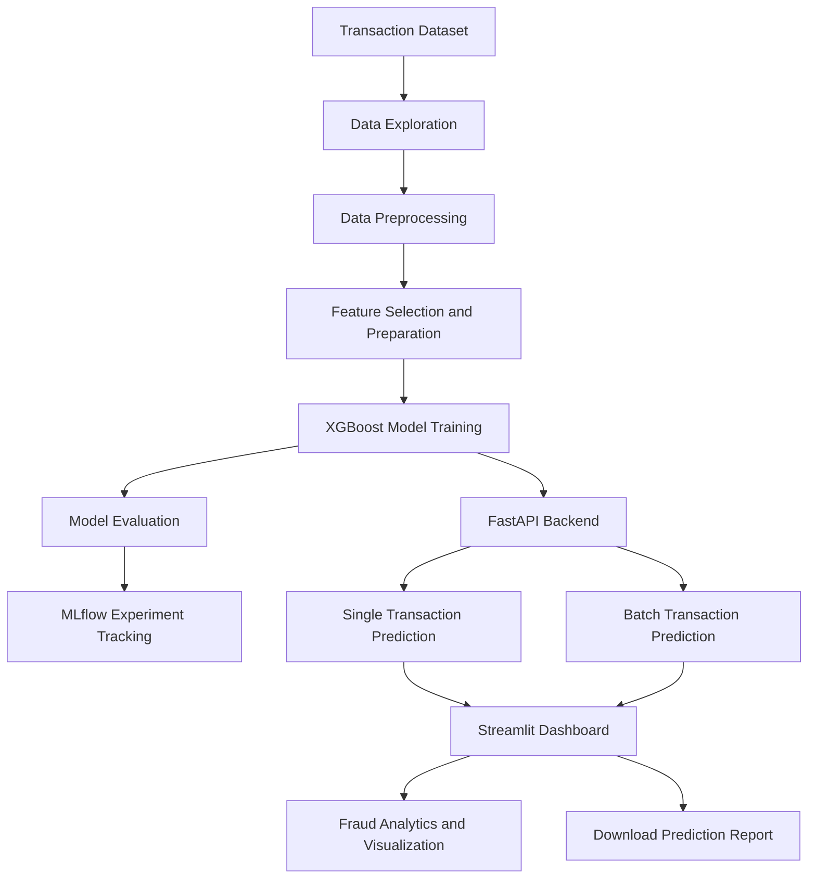

# 💳 Real-Time Financial Fraud Detection Platform

A machine learning-based financial fraud detection platform that identifies potentially fraudulent transactions using **XGBoost**. The project provides transaction risk scoring, batch prediction, an interactive dashboard, REST APIs, and experiment tracking using MLflow.

---

## 📌 Project Overview

Financial fraud is a major challenge in digital payment systems. Detecting fraudulent transactions accurately while minimizing false positives is important for financial institutions.

This project aims to develop a machine learning-based fraud detection system that analyzes transaction data and predicts the probability of fraudulent activity.

The platform combines a trained machine learning model with a FastAPI backend and a Streamlit dashboard to provide an interactive fraud detection experience.

---

## ✨ Features

- **Machine Learning Fraud Detection:** Uses XGBoost for binary classification of transactions.
- **Fraud Probability Scoring:** Calculates the probability of a transaction being fraudulent.
- **Individual Transaction Prediction:** Analyze transactions individually through an interactive interface.
- **Batch Prediction:** Upload a CSV file containing multiple transactions and generate predictions.
- **Interactive Dashboard:** Visualize transaction analytics, fraud predictions, and risk levels.
- **Risk Classification:** Categorizes transactions into Low, Medium, and High Risk.
- **Prediction Reports:** Download batch prediction results as CSV files.
- **REST API:** Provides prediction endpoints using FastAPI.
- **API Documentation:** Interactive API documentation through Swagger UI.
- **Experiment Tracking:** Track model performance and experiment metrics using MLflow.
- **Model Evaluation:** Evaluate model performance using Precision, Recall, F1-score, ROC-AUC, and PR-AUC.

---

## 🛠️ Tech Stack

| Technology | Purpose |
|---|---|
| Python | Programming language |
| Pandas | Data manipulation and preprocessing |
| NumPy | Numerical computations |
| Scikit-learn | Data preprocessing and model evaluation |
| XGBoost | Fraud detection classification model |
| FastAPI | REST API development |
| Streamlit | Interactive dashboard |
| MLflow | Experiment tracking |
| Matplotlib | Data visualization |
| Git & GitHub | Version control |

---

## 🏗️ Project Architecture



---

## 📂 Project Structure

```text
AIML-01/
│
├── artifacts/
│   └── model_metrics.json
│
├── dashboard/
│   └── app.py
│
├── src/
│   ├── preprocessing/
│   │   ├── explore_data.py
│   │   ├── inspect_features.py
│   │   └── prepare_data.py
│   │
│   ├── models/
│   │   ├── train_model.py
│   │   ├── threshold_tuning.py
│   │   └── track_experiment.py
│   │
│   ├── api/
│   │   └── main.py
│   │
│   ├── features/
│   ├── graph/
│   ├── streaming/
│   └── monitoring/
│
├── data/
│   ├── raw/
│   └── processed/
│
├── feature_store/
│
├── deployment/
│   └── kubernetes/
│
├── tests/
│
├── notebooks/
│
├── requirements.txt
│
└── README.md
```

---

## 📊 Dataset

The project uses the **IEEE-CIS Fraud Detection Dataset** available on Kaggle.

Dataset link:

[IEEE-CIS Fraud Detection – Kaggle](https://www.kaggle.com/competitions/ieee-fraud-detection)

The dataset contains transaction information and identity-related features that can be used to identify potentially fraudulent transactions.

### Dataset Characteristics

- Approximately 590,000 training transactions
- Hundreds of transaction and identity-related features
- Binary target variable: `isFraud`
- Highly imbalanced dataset containing legitimate and fraudulent transactions

The dataset is not included in this GitHub repository due to its size.

---

## ⚙️ Data Preprocessing

The preprocessing pipeline includes:

- Dataset exploration
- Feature inspection
- Selection of relevant transaction features
- Handling missing values
- Categorical feature conversion
- Preparation of model-ready data
- Chronological train-validation split

---

## 🤖 Machine Learning Model

The project uses **XGBoost Classifier** to predict whether a transaction is fraudulent or legitimate.

### Model Configuration

| Parameter | Value |
|---|---|
| Algorithm | XGBoost Classifier |
| Number of Estimators | 300 |
| Maximum Depth | 6 |
| Learning Rate | 0.05 |
| Subsample | 0.8 |
| Column Sample | 0.8 |
| Evaluation Metric | AUC-PR |
| Random State | 42 |

The model uses class weighting to account for the imbalance between fraudulent and legitimate transactions.

---

## 📈 Model Performance

The model was evaluated using a chronological validation dataset.

| Evaluation Metric | Score |
|---|---:|
| PR-AUC | 0.4003 |
| ROC-AUC | 0.8779 |
| Precision | 0.1425 |
| Recall | 0.7429 |
| F1-Score | 0.2391 |

### Confusion Matrix

At a classification threshold of 0.50:

| | Predicted Legitimate | Predicted Fraud |
|---|---:|---:|
| Actual Legitimate | 95,870 | 18,174 |
| Actual Fraud | 1,045 | 3,019 |

The classification threshold can be adjusted based on the desired balance between detecting fraud and reducing false-positive alerts.

The prototype currently uses a threshold of **0.70** for its prediction interface.

---

## 📉 Threshold Optimization

Different classification thresholds were evaluated to understand their impact on precision, recall, and F1-score.

The threshold of 0.70 achieved the highest F1-score among the thresholds tested.

| Threshold | Precision | Recall | F1-Score |
|---|---:|---:|---:|
| 0.30 | 0.0840 | 0.8883 | 0.1535 |
| 0.40 | 0.1103 | 0.8250 | 0.1946 |
| 0.50 | 0.1425 | 0.7429 | 0.2391 |
| 0.60 | 0.1867 | 0.6437 | 0.2894 |
| 0.70 | 0.2464 | 0.5364 | 0.3377 |

---

## 📊 Dashboard

The Streamlit dashboard provides an interactive interface for fraud detection and transaction analysis.

### Dashboard Capabilities

- Individual transaction analysis
- Fraud probability visualization
- Transaction prediction history
- Transaction analytics
- CSV batch upload
- Batch fraud prediction
- Risk-level classification
- High-risk transaction identification
- Fraud prediction charts
- Downloadable prediction reports

### Dashboard Screenshots

Screenshots of the application will be added here.

#### Main Dashboard

<!-- Add dashboard screenshot here -->

#### Individual Transaction Prediction

<!-- Add individual prediction screenshot here -->

#### Batch Transaction Analysis

<!-- Add batch prediction screenshot here -->

#### Fraud Probability Visualization

<!-- Add fraud probability chart screenshot here -->

---

## 🚀 Installation and Setup

### 1. Clone the Repository

```bash
git clone https://github.com/Nehalshaikh8698/AIML-Projects.git
```

Navigate into the project folder:

```bash
cd AIML-Projects/AIML-01
```

### 2. Create a Virtual Environment

```bash
python -m venv venv
```

### 3. Activate the Virtual Environment

Windows PowerShell:

```powershell
venv\Scripts\Activate.ps1
```

### 4. Install Dependencies

```bash
pip install -r requirements.txt
```

---

## 📥 Dataset Setup

Download the IEEE-CIS Fraud Detection dataset from Kaggle.

Place the required CSV files inside:

```text
data/raw/
```

Required files:

```text
train_transaction.csv
train_identity.csv
test_transaction.csv
test_identity.csv
sample_submission.csv
```

---

## 🧠 Model Training

Run the data preprocessing script:

```bash
python src/preprocessing/prepare_data.py
```

Train the fraud detection model:

```bash
python src/models/train_model.py
```

The trained model and evaluation metrics are saved locally in the `artifacts/` directory.

---

## 📊 MLflow Experiment Tracking

Run the experiment tracking script:

```bash
python src/models/track_experiment.py
```

Start the MLflow UI:

```bash
mlflow ui --backend-store-uri sqlite:///mlflow.db
```

Open:

```text
http://127.0.0.1:5000
```

MLflow provides a centralized interface to review experiment parameters, evaluation metrics, and logged artifacts.

---

## 🌐 FastAPI Backend

Start the API server:

```bash
uvicorn src.api.main:app --reload
```

The API will be available at:

```text
http://127.0.0.1:8000
```

### API Endpoints

| Endpoint | Method | Description |
|---|---|---|
| `/` | GET | API welcome endpoint |
| `/health` | GET | Health check |
| `/predict` | POST | Predict a single transaction |
| `/predict/batch` | POST | Predict multiple transactions |

### Interactive API Documentation

Swagger UI:

[http://127.0.0.1:8000/docs](http://127.0.0.1:8000/docs)

---

## 🖥️ Streamlit Dashboard

Open a second terminal and run:

```bash
streamlit run dashboard/app.py
```

The dashboard will open at:

```text
http://localhost:8501
```

Make sure the FastAPI backend is running before using the dashboard.

---

## 🔄 Application Workflow

1. Transaction data is collected from the dataset.
2. Data is explored and preprocessed.
3. Relevant features are selected.
4. The XGBoost model is trained.
5. Model performance is evaluated.
6. Experiments and metrics are tracked using MLflow.
7. FastAPI exposes prediction endpoints.
8. Streamlit communicates with the API.
9. Transactions are analyzed and classified.
10. Prediction results and analytics are displayed.
11. Batch results can be downloaded as CSV reports.

---

## 🔮 Future Improvements

- Real-time transaction streaming using Apache Kafka
- Fraud-ring detection using graph analytics
- Graph neural networks for suspicious account relationship detection
- Feature store integration using Feast
- Model monitoring and data drift detection using Evidently AI
- Model deployment using Docker and Kubernetes
- Improved model explainability using SHAP
- Automated model retraining pipeline
- Enhanced fraud investigation dashboard

---

## 👨‍💻 Author

**Nehal Shaikh**

AI & Data Science Engineering Graduate

This project was developed as part of an AI/ML internship project.

---

## ⚠️ Disclaimer

This project is developed for educational and internship purposes. The model predictions are experimental and should not be used as the sole basis for real-world financial decisions.
