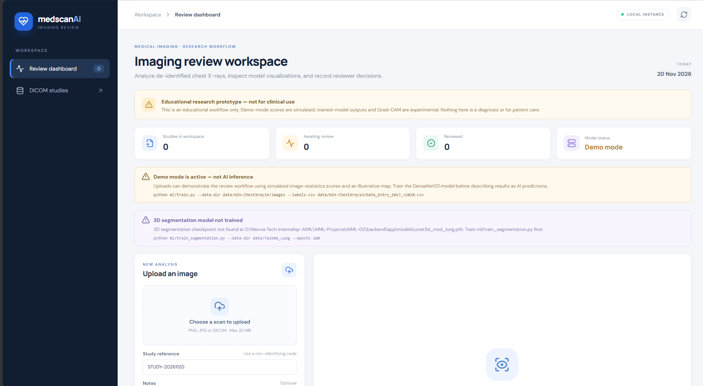
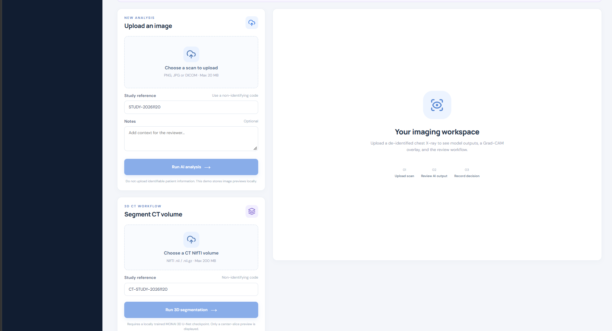
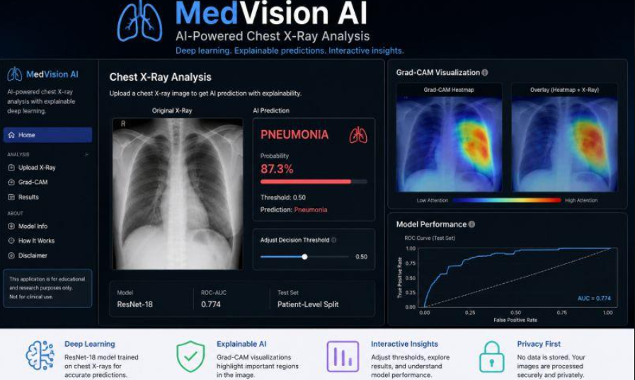
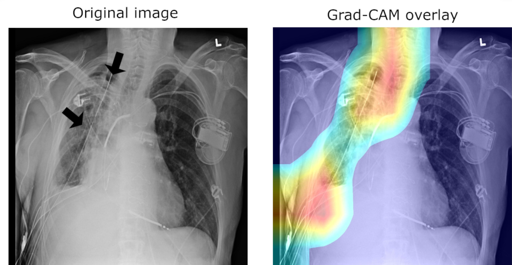
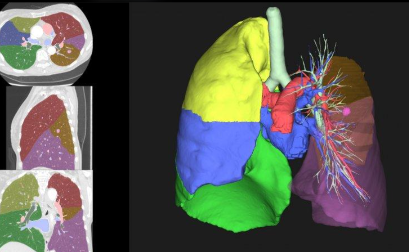
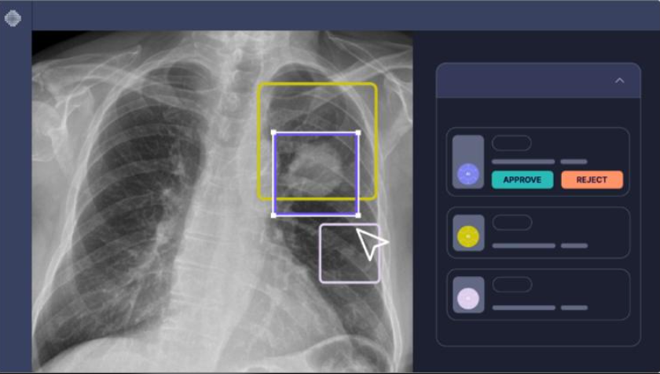
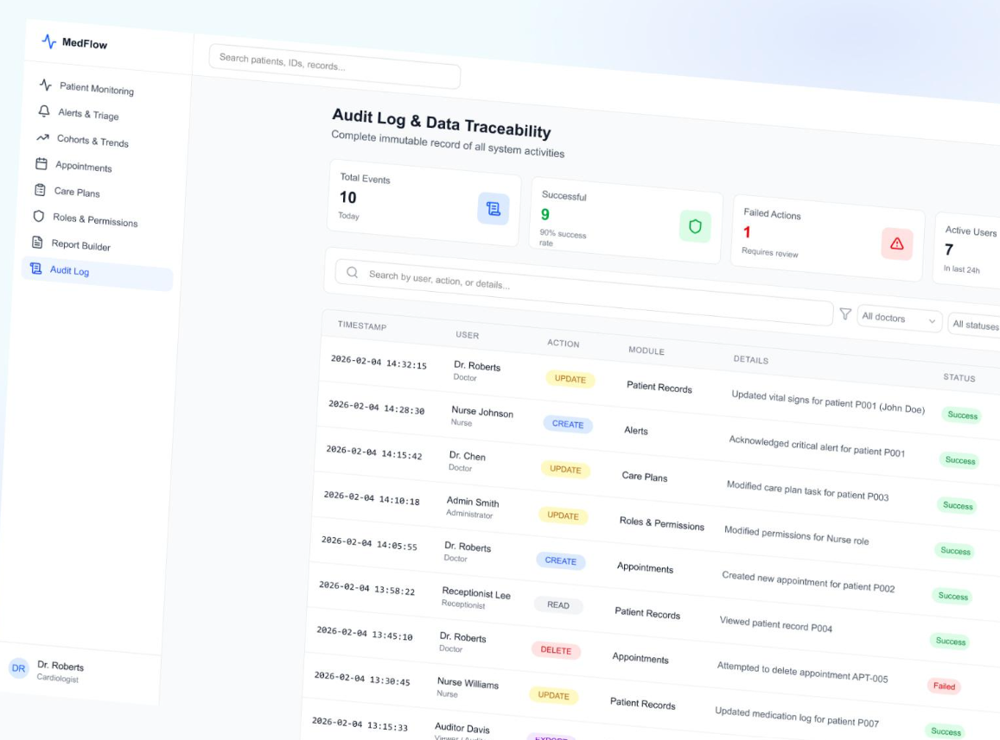
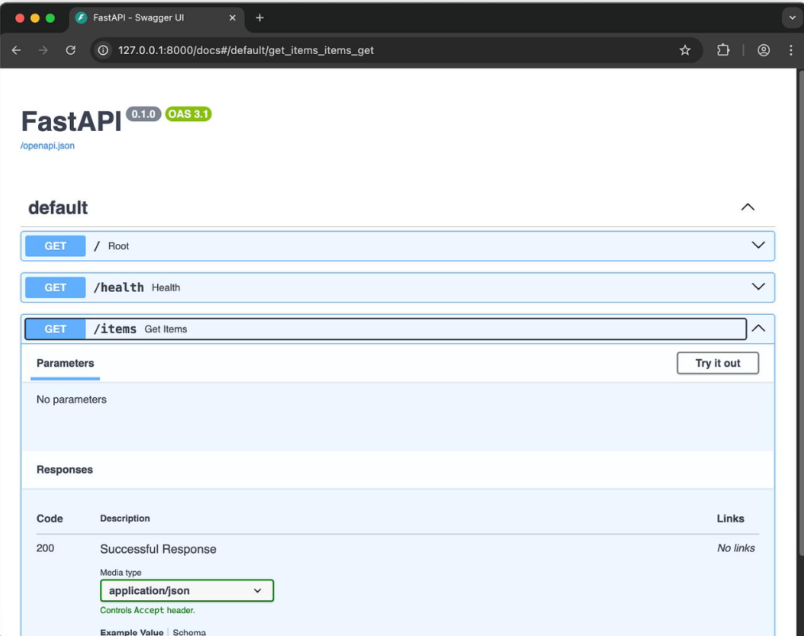

# 🏥 MedScan AI – AI-Assisted Medical Imaging and Diagnosis System

An AI-powered medical imaging platform designed to assist with the analysis and visualization of medical images, including X-rays, CT scans, and MRI scans.

MedScan AI combines deep learning, medical image processing, explainable AI, and a doctor review workflow to provide an integrated medical imaging analysis platform.

> **Disclaimer:** MedScan AI is an educational and research project. It is not a certified medical device and must not be used for clinical diagnosis or treatment decisions.

---

## 📌 Project Overview

Medical imaging plays an important role in identifying and monitoring diseases. However, reviewing large volumes of medical images can be time-consuming.

MedScan AI aims to simplify this process by providing a platform where users can:

- Upload medical images.
- Process and analyze imaging studies.
- Generate AI-assisted analysis results.
- Visualize model explanations using Grad-CAM.
- Perform medical image segmentation.
- Review analysis results through a doctor review interface.
- Maintain study history and audit logs.

The system is designed with a modular architecture so that trained deep learning models and additional medical imaging services can be integrated.

---

## ✨ Key Features

### 1. Medical Image Upload
- Upload X-ray images.
- Support medical imaging workflows for CT and MRI.
- Validate uploaded files.
- Store study information and metadata.

### 2. AI-Based Image Analysis
- Deep learning-based image classification architecture.
- Designed for chest X-ray analysis.
- Supports integration with trained DenseNet121 models.
- Provides a demo mode when trained model weights are unavailable.

### 3. Explainable AI – Grad-CAM
- Visual explanation of model predictions.
- Highlights image regions that influence model output.
- Helps users understand model behavior.

*Actual Grad-CAM visualizations require a trained model checkpoint.*

### 4. Medical Image Segmentation
- Designed for 3D medical image segmentation.
- Supports integration of segmentation models.
- Provides a foundation for CT and MRI volume analysis.

### 5. Doctor Review System
- Review uploaded medical studies.
- Record approval or rejection decisions.
- Add reviewer comments.
- Maintain review history.

### 6. Audit Logging
- Record important study-related activities.
- Track review actions.
- Maintain persistent audit events using MongoDB when available.

### 7. API Documentation
- REST API developed using FastAPI.
- Interactive API documentation through Swagger UI.
- Structured endpoints for study management and image processing.

---

## 🛠️ Tech Stack

| Category | Technologies |
|---|---|
| Frontend | React.js, Vite, JavaScript |
| Backend | Python, FastAPI |
| Deep Learning | PyTorch |
| Medical Imaging | MONAI, DICOM |
| Explainable AI | Grad-CAM |
| Database | MongoDB |
| Medical Image Server | Orthanc |
| Experiment / Data Versioning | DVC |
| Containerization | Docker |
| API Testing | Swagger UI |

---

## 🏗️ System Architecture

```text
              USER
                |
                v
        React Frontend
                |
                v
          FastAPI Backend
                |
       +--------+---------+
       |        |         |
       v        v         v
   Image      Study     Doctor
  Processing  Storage   Review
       |        |         |
       v        v         v
   Deep Learning       Audit Logs
       |
   +---+----------------+
   |                    |
   v                    v
Classification      Segmentation
   |
   v
 Grad-CAM
   |
   v
Analysis Results
   |
   v
 React Dashboard
```

---

## 📂 Project Structure

```text
AIML-02/
│
├── docs/
│   ├── architecture.md
│   └── screenshots/
│       ├── 01-dashboard.png
│       ├── 02-upload.png
│       ├── 03-analysis.png
│       ├── 04-gradcam.png
│       ├── 05-segmentation.png
│       ├── 06-doctor-review.png
│       ├── 07-audit-logs.png
│       └── 08-api-docs.png
│
├── backend/
│   ├── app/
│   │   ├── api/
│   │   ├── core/
│   │   ├── models/
│   │   ├── services/
│   │   └── main.py
│   ├── tests/
│   ├── requirements.txt
│   └── Dockerfile
│
├── frontend/
│   ├── src/
│   │   ├── components/
│   │   └── ...
│   ├── package.json
│   └── index.html
│
├── ml/
│   ├── train.py
│   ├── train_segmentation.py
│   ├── prepare_metadata.py
│   └── requirements.txt
│
├── orthanc/
│   └── orthanc.json
│
├── tests/
├── docker-compose.yml
├── dvc.yaml
├── .env.example
├── .gitignore
├── NOTICE
└── README.md
```

---

## ⚙️ Installation and Setup

### Prerequisites

Install the following before running the project:

- Python 3.10 or later (use a version supported by the project dependencies).
- Node.js and npm.
- MongoDB.
- Git.

### 1. Clone the Repository

```bash
git clone https://github.com/Nehalshaikh8698/AIML-Projects.git
```

Navigate to the project:

```bash
cd AIML-Projects/AIML-02
```

### 2. Backend Setup

Navigate to the backend directory:

```bash
cd backend
```

Create a virtual environment:

```bash
python -m venv .venv
```

Activate it on Windows:

```powershell
.\.venv\Scripts\Activate.ps1
```

Install dependencies:

```bash
python -m pip install --upgrade pip
pip install -r requirements.txt
```

Configure environment variables using the provided `.env.example` file. Ensure MongoDB is running and the database connection settings are correct.

Start the backend:

```bash
uvicorn app.main:app --reload --host 0.0.0.0 --port 8000
```

Backend URL:

`http://localhost:8000`

Swagger API documentation:

`http://localhost:8000/docs`

### 3. Frontend Setup

Open another terminal:

```bash
cd AIML-Projects/AIML-02/frontend
```

Install dependencies:

```bash
npm install
```

Start the development server:

```bash
npm run dev
```

Frontend URL:

`http://localhost:5173`

---

## 📸 Application Screenshots

### 1. Dashboard



### 2. Medical Image Upload



### 3. Image Analysis



### 4. Grad-CAM Visualization



### 5. Medical Image Segmentation



### 6. Doctor Review



### 7. Audit Logs



### 8. API Documentation



---

## 🔌 API Endpoints

The backend exposes REST API endpoints for medical study management.

| Method | Endpoint | Description |
|---|---|---|
| GET | `/` | Root endpoint |
| GET | `/health` | Application health information |
| GET | `/api/studies` | Retrieve medical studies |
| POST | `/api/studies/upload` | Upload a medical image |
| GET | `/api/studies/{study_id}` | Retrieve a specific study |
| POST | `/api/studies/{study_id}/review` | Submit a doctor review |
| GET | `/api/studies/{study_id}/audit` | Retrieve study audit history |
| POST | `/api/ct/segment` | CT segmentation workflow |

For complete request and response details, visit:

`http://localhost:8000/docs`

---

## 🧠 Machine Learning

The project includes a machine learning pipeline designed for medical image analysis.

### Classification

- DenseNet121-based architecture.
- Designed for chest X-ray classification.
- Training pipeline available in `ml/train.py`.

### Segmentation

- Separate training pipeline available in `ml/train_segmentation.py`.
- Designed for 3D medical image segmentation workflows.

### Explainability

Grad-CAM is intended to provide visual explanations of model predictions by highlighting influential image regions.

### Model Availability

The application currently supports demo mode when trained model checkpoints are unavailable.

For actual model inference and explainability, the required trained model weights must be generated and placed in the configured model checkpoint locations.

Demo outputs must not be interpreted as genuine medical predictions.

---

## 📚 Potential Datasets

The following publicly available research datasets can be considered for model development, subject to their respective access requirements and usage licenses:

| Dataset | Purpose |
|---|---|
| NIH ChestX-ray14 | Chest X-ray classification |
| CheXpert | Chest X-ray classification |
| RSNA Pneumonia | Pneumonia detection research |
| MIMIC-CXR | Chest X-ray research |
| Medical Segmentation Decathlon | Medical image segmentation |
| BraTS | Brain tumor segmentation research |
| LIDC-IDRI | Lung nodule imaging research |

Dataset access, licensing, preprocessing, and storage requirements should be checked before use.

---

## 🔐 Security and Privacy

- Avoid uploading identifiable patient information.
- Use de-identified research images.
- Protect database credentials through environment variables.
- Keep model weights and datasets outside public Git repositories.
- Apply appropriate access controls before deploying the application.

---

## ⚠️ Limitations

- The application is intended for educational and research purposes.
- Demo mode may return simulated results when trained model checkpoints are unavailable.
- Model performance has not been clinically validated.
- Grad-CAM requires an available trained classification model.
- Segmentation quality depends on the availability and training of a suitable segmentation model.
- The application is not a replacement for qualified medical professionals.

---

## 🚀 Future Enhancements

- Integrate additional trained medical imaging models.
- Improve multi-class disease classification.
- Complete 3D CT and MRI segmentation workflows.
- Integrate Orthanc for DICOM storage and retrieval.
- Enhance Grad-CAM visualization.
- Add role-based authentication for doctors and administrators.
- Improve model evaluation and monitoring.
- Deploy the application using Docker and cloud infrastructure.

---

## 👨‍💻 Author

**Nehal Amanulla Shaikh**

B.E. – Artificial Intelligence and Data Science

GitHub: [Nehalshaikh8698](https://github.com/Nehalshaikh8698)

Project Repository: [AIML-Projects](https://github.com/Nehalshaikh8698/AIML-Projects)

---

## 📄 License and Usage

This project is developed for educational and internship purposes. Refer to the repository's `NOTICE` file and individual dataset licenses for applicable usage and attribution requirements.

**MedScan AI – Exploring AI-assisted medical imaging through deep learning and explainable AI.**